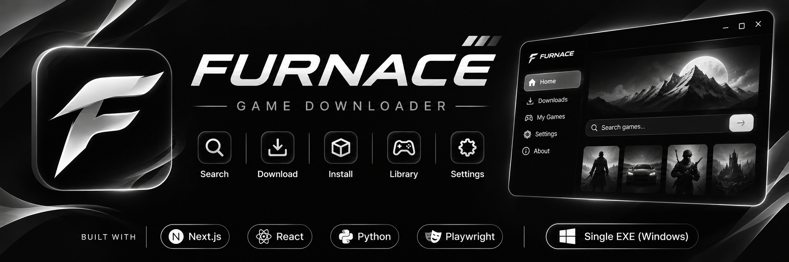

# FURNACE

**A modern game downloader and library manager for Windows.**

Search, download, install, and manage your games in one clean desktop app.

---

### About Furnace

**Furnace v3.0.0** combines a sleek black-and-white **React / Next.js** interface with a **Python-powered desktop engine**. Everything runs locally—no separate Furnace API server or catalogue database required.

### Highlights

- **Discover** — Search games through a streamlined interface.
- **Download** — Track download activity and progress.
- **Install** — Automate supported installation and verification steps.
- **My Games** — Launch and manage installed games in one place.

**Platform:** Windows 10 / 11 · **Release:** v3.0.0

**[Explore Furnace on our website]()**

